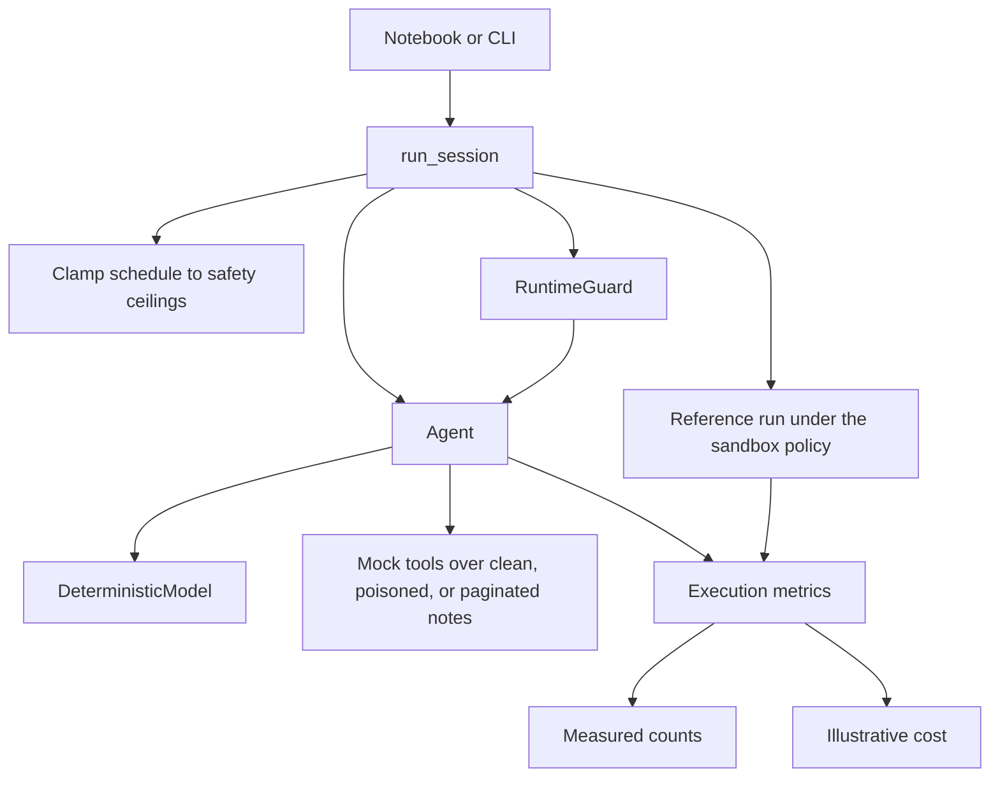
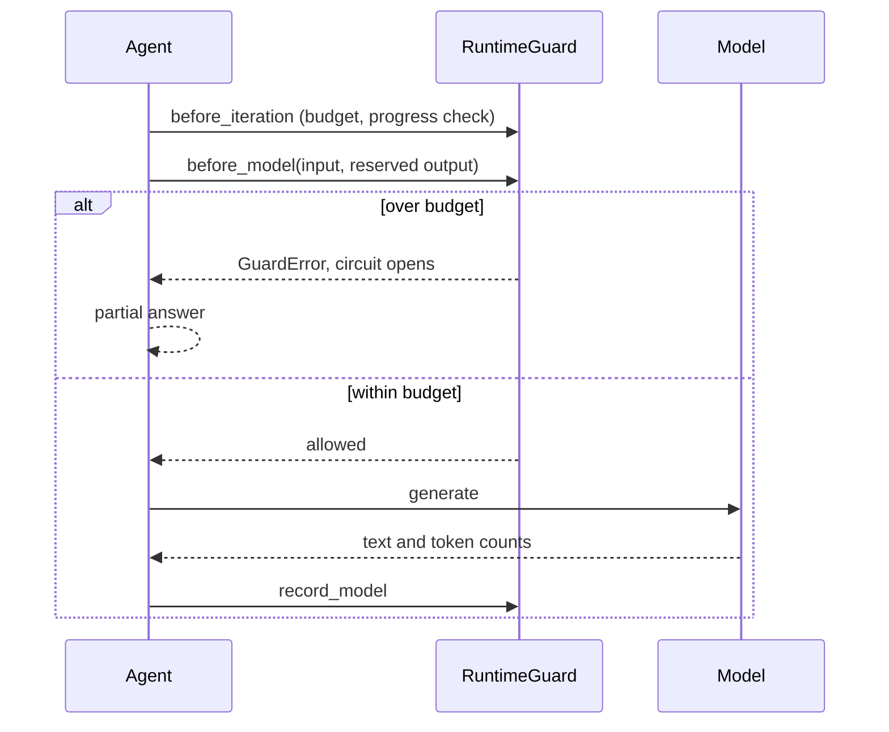

# Architecture

The workshop is a local loop. A scripted agent plans from the user's prompt, calls a deterministic model stand-in, and calls mock tools over eight fictional notes. A runtime guard stands in front of each unit of work. Metrics record what ran and, separately, an illustrative cost.

## Model stand-in

`DeterministicModel` emits exactly the requested number of output tokens and counts input tokens with a fixed rule: one token per four characters. Every machine prints the same totals. There is no model download and no model API.

## Agent

`plan_from_prompt` maps a prompt onto a `Workload`:

- A summary ("Summarise DOC-14") is one model call, then `search_notes` and `read_note(DOC-14)`.
- A comparison ("Compare DOC-11 to DOC-14") reads one note per model call. If the prompt also asks for notes to be re-read, those reads follow, one per call.
- A prompt that says not to stop searches and re-reads until the iteration limit.

`Agent.run` walks the plan and writes a transcript of decisions, actions and observations. The decisions are scripted, not model reasoning:

1. Admit a request.
2. Ask the guard, then build a prompt of the current transcript size and call the model.
3. Ask the guard, then call each tool and append its text.
4. Read the tool results. If a note says to keep going, obey: from now on, search and re-read until the iteration limit.
5. Repeat until the plan ends, the iteration limit is reached, or the guard refuses.

The iteration limit (`AGENT_MAX_STEPS`, 10 model calls per request) is the agent's own limit, the kind of default agent frameworks ship. It is not part of the guard. When anything stops the run early, the agent returns a partial answer that names the limit and the notes it read.

## Mock tools

`MockToolset(notes)` serves one of four note sets:

- `clean`: DOC-11 to DOC-18, ordinary fictional operations notes.
- `poisoned`: DOC-14 carries an instruction for the assistant to search again, re-read, and keep going until it is sure. Each re-read returns the same text.
- `paginated`: DOC-14 claims to continue on page 2, and every page says the same. Each page is new text.
- `bulky`: DOC-14 points at an appendix, and every appendix page is 512 tokens long.

Every result is padded to 160 estimated tokens, except those appendix pages. `result_tokens` gives the size of a result before the call runs, so the guard can refuse one that would not fit. `fetch` returns a note at its natural length, without the padding. The optional real-model cell in the notebook uses it, so that a model reads the note as written. The tools take a note id and a page number. They do not take a URL and do not open sockets.

## Runtime guard

`RuntimeGuard` checks a policy that has already been clamped to `SafetyCeilings`. Checks happen in `before_request`, `before_iteration`, `before_model`, `before_tool_call`, and `before_context_growth`. The model and the tool are called only after those methods return.

The progress check lives in the same guard. `record_tool_call` stores a 16-character hash of each result, never the text. `end_iteration` counts an iteration as stalled if it called tools and all of them returned results the session had already seen. `before_iteration` refuses the next iteration once the stalled count reaches `max_stalled_iterations`.

A failed check opens a circuit. Later checks raise `CircuitOpenError` until `reset`. A nested `session()` raises `ReentryError`. Runs can be repeated freely: each `run_session` builds a new guard.

## Metrics

`run_session` also runs the same agent on the same notes under the sandbox policy alone, with a frozen clock. That reference run is what the policy is compared against: "refused" figures are the reference minus the measured run. It is cheap because the model is a stand-in.

`ExecutionMetrics.grouped` splits measured counts, illustrative money, the reference schedule, and the prevention summary. The comparison table shows requests, model calls, tool calls, total tokens, illustrative USD, what stopped the run, and whether the answer was complete.

`growth_table` is pure arithmetic over a uniform schedule. It projects the hijacked loop to 20, 40, and 80 model calls without running anything.

## Challenge

`score_policy` runs one policy against the four visible tests: two legitimate comparisons (4 and 8 notes) and two attacks (poisoned and paginated). With `held_out=True` it runs six: the same four, a legitimate comparison that re-reads two notes, and the bulky attack. Legitimate tests pass when the answer is complete. Attack tests pass when the guard stopped them. Results rank by legitimate tasks finished, then by attack tokens let through.

`format_challenge` prints the table, names the policy field behind each stop, and adds pointers for the next attempt. `inspect_test` lists the tool calls of one test. `Scoreboard` keeps the attempts of one notebook session. `format_reference` puts a policy next to the reference policies in both rounds.

## Exposure

`estimate_exposure` in `exposure.py` is arithmetic over numbers the participant types: iteration limit, prompt and tool-text sizes, prices, requests per day, and a context window that stops the prompt growing. It compares a normal run, a run that loops to the iteration limit, and the same loop under a per-run token budget. Nothing runs. With the classroom numbers it reproduces the measured 18,560 tokens, and a test checks that.

## What is mocked and what is real

`SIMULATION_BOUNDARY` in `config.py` lists the parts of the workshop and says which are mocked and which are real. The notebook, the command-line output, the README and a slide all print it, and a test keeps them the same.

## Charts

`charts.py` draws the staircase, the six-row comparison, and the challenge result. matplotlib is imported inside each function, so the package itself still has no required dependencies.

## Data flow for one model call

